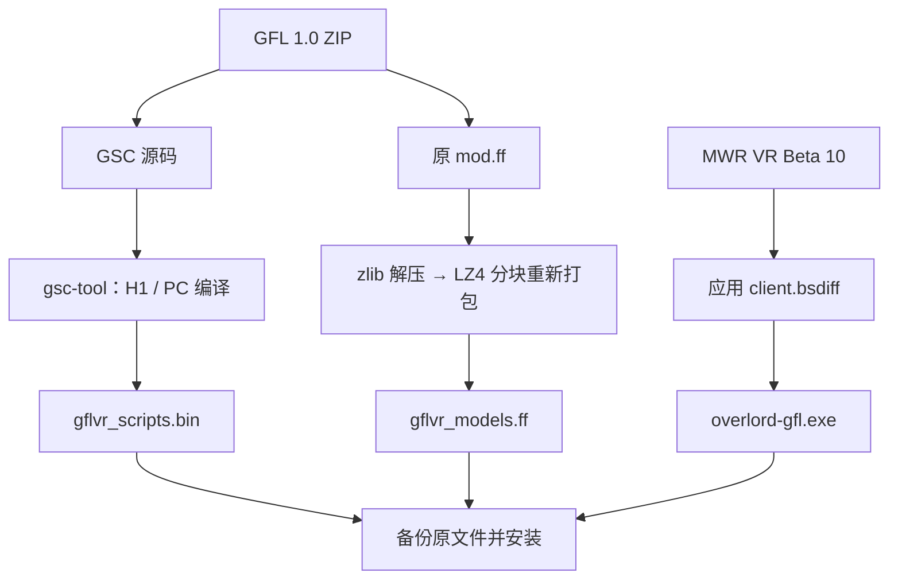

# 工作原理

GriffinVR Bridge 将 GFL 1.0 的资源接入 MWR VR Beta 10。原 Mod 的角色替换逻辑保持不变，兼容层负责资源格式、查找入口和脚本内存生命周期。

## 安装期：生成兼容资源

`installer/payload.py` 固定并校验输入版本。在临时目录中生成全部产物并验证完成后，`installer/manage.py` 才记录备份和安装清单，再替换目标文件。

- **脚本编译**：使用 `gsc-tool -m comp -g h1 -s pc`，将 316 个 `.gsc` 编译为 `.gscbin`。失败或输出数量不符都会中止。
- **脚本归档**：`installer/build_gfl_zones.py` 写入 `GFL1` 标记、记录数，以及每份脚本的名字与完整编译结果。少数脚本使用 H1 内置路径编号，其余保留路径名称；本包所需的五项编号保存在 `installer/data/h1-paths.txt`。
- **资源重新打包**：将 GFL 的 zlib 模型资源流解压，按 64 KiB 分块使用 LZ4 压缩，并写入原生 H1 资源包头。模型、骨骼和贴图内容不变；每一块都解压回验，最终文件再核对固定哈希。
- **客户端补丁**：将已验证的 `client.bsdiff` 应用到固定 VR 客户端，得到包含兼容加载器的 `overlord-gfl.exe`。GSC 编译器不会生成这段 C++ 加载逻辑。

玩家包自带 Python 与 LZ4。GSC 编译器在安装期自动获取；这些工具不参与游戏运行期的脚本执行。

## 运行期：交给游戏引擎加载与执行

`Play-GFL-VR.exe` 启动 `overlord-gfl.exe -singleplayer -mod mods\gfl`，默认使用 OpenVR，并设置 Windows HighQoS。参数选中兼容功能；原版 VR 客户端不会因此自动具备兼容加载器。

`overlay/src/client/component/gfl_campaign.cpp` 负责：

1. 检查启用的 Mod 与资源文件，并核对即将修改的引擎调用位置。
2. 在公共资源加载阶段加入 `gflvr_models.ff`。
3. 读取 `gflvr_scripts.bin`，建立脚本名称索引。
4. 在引擎查找脚本时优先返回少前版本；未命中时回退到游戏原有查找。
5. 将字节码复制到当前关卡的脚本内存区，由 H1 链接器和脚本虚拟机处理。
6. 关卡脚本卸载后释放副本，下次加载重新复制。H1 链接器会原地改写字节码，所以不能跨关卡反复链接同一个已修改副本。

`memory.cpp` 调整 H1 资源与脚本内存布局；`ui_scripting.cpp` 接入 GFL 菜单；`mwr_port.hpp` 启用兼容组件。`native_melee.cpp` 保留使固定上游基线可构建的必要修改，未启用其中仍禁用的 H2 近战事件分支。

## 更新边界

- 玩家首次接入时，需要兼容客户端、脚本包和重新打包后的模型资源；只复制脚本或追加启动参数不足以启用功能。
- 已安装兼容版、且变更只涉及调用已有模型的脚本逻辑时，可以只更新脚本产物；发布安装器还需同步其哈希校验。
- 修改 GFL 输入版本、模型内容或 VR 基线时，需要重新适配并验证，不能仅替换版本字符串。

模型资源在玩家本机生成；仓库不保存 GFL 脚本、模型包或游戏数据。
